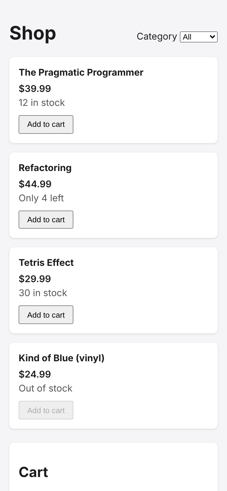
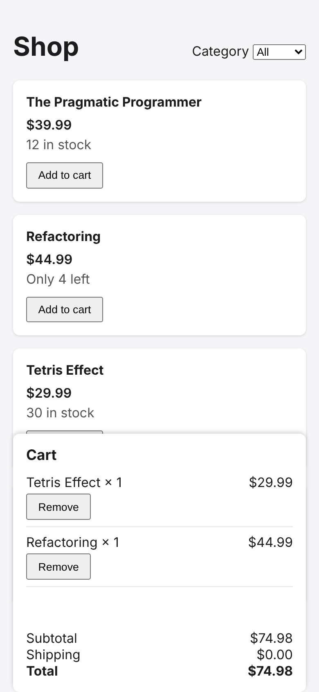
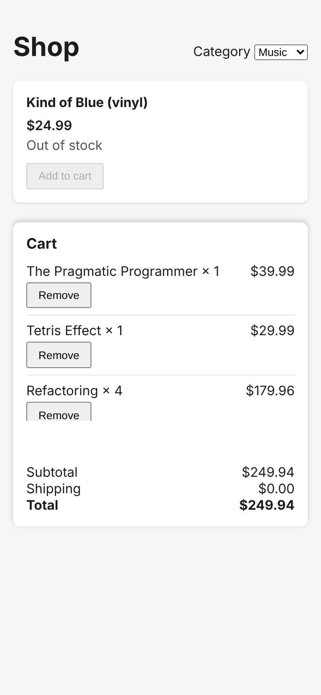

# QA: the storefront page (SHOP-40), two passes and the fixes between them

The [qa](https://github.com/Akiles94/ai-dev-toolkit/blob/main/docs/qa.md) agent on the page the [storefront example](../storefront/) built with the full workflow, which the reviewer had passed. Mode `block`, every answer typed by hand. The first pass failed with three 🟡; the fixes went through the workflow as SHOP-41; the second pass found them fixed, and one new 🟡 that a fix brought.

| Before: QA-03 | After the fix | QA-05, from the fix |
|---|---|---|
|  |  |  |

*Screenshots of `aidt qa walk` on a phone (390 × 844): walk 09 on SHOP-40, the same walk on SHOP-41, walk 10 on SHOP-41.*

- Reports: [pass 1](../../.aidt/tasks/feat-SHOP-40-storefront/qa/block-storefront.md), [pass 2](../../.aidt/tasks/feat-SHOP-40-storefront/qa/block-storefront-pass2.md).
- [walks/](../../.aidt/tasks/feat-SHOP-40-storefront/qa/walks/): the ten walks the agent wrote; `aidt qa walk <file>` plays any of them again, with no tokens.
- [.aidt/app.md](../../.aidt/app.md): its «QA» part, drafted by the agent and approved with the scope.
- [SHOP-41](../../.aidt/tasks/fix-SHOP-41-storefront-qa-findings/): the fixes' spec, plan and review guides.

## What it found

| Id | Pass | Sev. | What a person meets | Now |
|---|---|---|---|---|
| QA-01 | 1 | 🟡 | «No more in stock» stays on screen after the filter changes, about a product no longer shown | fixed in SHOP-41 |
| QA-02 | 1 | 🟡 | A `null` or malformed body to `POST /carts/:id/items` answers 500, not 400 | fixed in SHOP-41 |
| QA-03 | 1 | 🟡 | On a phone the cart is below every card: «Add to cart» shows nothing | fixed in SHOP-41 |
| QA-04 | 1 | ℹ️ | Whoever has a cart id can read and change that cart | a decision for the user |
| QA-05 | 2 | 🟡 | On a phone, the docked cart cuts the third line's «Remove» in half, with no sign the list scrolls | brought by the QA-03 fix; a decision for the user |

The storefront had passed review, with 34 tests green. None of these were in its diff as a defect: they show when the page is used, on a phone, after a filter change, or with a body the page never sends.

**The QA and the reviewer, on the same fix.** In SHOP-41 the reviewer failed S3 from reading its CSS: a sticky cart in a one-row grid area, it reasoned, could not dock. Replaying the QA's walk 09 at phone width showed it docked; with that screenshot the reviewer withdrew the finding. Then the second pass found what neither the tests nor the review saw: with three lines, the docked cart cuts a button in half.

## Cost

| Step | Model | Turns | Agent time | Tokens in (cached) | Tokens out | Cost at API prices |
|---|---|---|---|---|---|---|
| QA pass 1: scope and cost | `claude-sonnet-5-5` | — | 18 s | 114k (72k) | 2.4k | $0.14 |
| QA pass 1: 9 walks, 15 runs, the report | `claude-sonnet-5-5` | 41 | 3 min 8 s | 1.75M (1.69M) | 17.6k | $0.59 |
| SHOP-41 refiner | `claude-sonnet-5-5` | 10 | 41 s | 373k (350k) | 5.5k | $0.18 |
| SHOP-41 planner | `claude-sonnet-5-5` | 10 | 1 min 8 s | 500k (480k) | 8.8k | $0.22 |
| SHOP-41 builder, 3 sections | `claude-sonnet-5-5` | 35 | 1 min 36 s | 1.98M (1.96M) | 12.5k | $0.41 |
| SHOP-41 reviewer | `claude-sonnet-5-5` | — | 1 min 44 s | 464k (395k) | 16.7k | $0.38 |
| SHOP-41 reviewer, S3 again with the walk's screenshot | `claude-sonnet-5-5` | — | 1 min 4 s | 691k (641k) | 9.9k | $0.29 |
| QA pass 2: 4 walks, 7 runs, the report | `claude-sonnet-5-5` | — | 1 min 40 s | 773k (729k) | 7.7k | $0.26 |
| **Total** | | | | | | **$2.45** |

- **The QA itself: $0.98** for the two passes ($0.73 and $0.26). The walks cost no tokens: each one ran in 2 to 10 seconds. The rest is the fixes, a block like any other.
- **The approval round.** The first call after the scope stopped at its first `aidt qa walk`: in the conversation that goes on after a skill's proposal, Claude Code asks before running a command, and headless nobody could answer. The agent asked instead of working around it (no `curl`, no script of its own). In an interactive session that is one click; here it was a second message, and its cost is in the $0.59.
- **The estimate.** The scope estimated 185,000 tokens; Claude Code counted 1.86 million, most of them the conversation read again from the cache at a tenth of the price. The agent's estimate now counts about 200,000 tokens per walk.
- **The plan check.** The planner went through `.aidt/practices/plan-check.md`, installed with the QA: it named the older journeys the second pass would walk, and added a note for the offline message.

Measured with Claude Code 2.1.327, headless (`claude -p`), on 2026-11-18. Agents that run apart from the conversation (the QA's first call and second pass, the reviewer) report no turns. With a Claude subscription the runs count toward usage limits instead.

## What changed in the toolkit after this run

The first pass showed two things about `aidt qa walk` itself, fixed before the second:

- In walk 07, the agent put `as` on each of the intruder's steps, then a `reload` and a `look` without it, meant for the shopper. `as` used to carry over to the next steps, so the intruder reloaded and looked at a blank page, and the report said the shopper's page showed the change: a sentence the walk never showed. Now `as` names who does that one step, a page step for a person with no page open stops the walk and says so, and the agent writes under «Seen» only what the log shows. The finding itself (QA-04, steps 4 to 6) stands.
- The second pass walked without proposing a scope again, which is what its scope says (the first report's findings and «Not covered»); the agent now says so.

## The conversation

### Pass 1: scope and cost

**You:**

```text
/qa block on feat/SHOP-40-storefront: the storefront page this branch built. The shop is already running at http://localhost:3000 (npm start).
```

**Agent:**

**Scope proposal for QA `block` mode on `feat/SHOP-40-storefront`. Nothing has been walked yet and no verdict is given.**

The worktree is clean, so a later verdict would bind to commit `51814c5`. `.aidt/app.md` has a «QA» part that reads "Not filled", so a draft is included below for you to approve with the scope. My limits don't let me run `curl`, so I haven't confirmed that the shop answers at http://localhost:3000. `aidt qa walk` will check that before the first walk.

**1. Journeys changed**
The storefront page at `/` is new: `public/index.html`, `app.js`, `shop-view.js`, `cart-session.js`, `style.css`, plus `src/static.ts` and a 3-line change in `server.ts`. The journeys are:
- **J1 Browse:** open `/`, see four products with price and stock label, filter by category.
- **J2 Add to cart:** add a product, see the line, subtotal, shipping and total. Cover the out-of-stock product (Kind of Blue) and Refactoring × 4 followed by "No more in stock".
- **J3 Remove:** take a line out of the cart and check the totals.
- **J4 Come back:** reload, leave and return, restart the shop (state is lost), or clear storage.

**2. Journeys touched, and the assumption each relied on**
- **API cart flow** (`POST /carts`, items, `GET`, `DELETE`): this was built for one caller.
  - It now has a browser caller that stores the cart id in `localStorage`.
  - Open questions: can another person's cart id be reused, and what does a double click do?
- **`GET /products?category=`:** the page ignores it and filters locally. The category list is duplicated in `index.html`, so a new category could drift from the API.
- **Server 404 fallback:** static paths now answer before it. The plan says `/../package.json` and `/unknown` still return 404 JSON.

**3. Promises**
- The page's own text: "No more in stock", "Only N left", "Something went wrong. Try again."
- The shipping rule "free from $50".
- `AGENTS.md` and `.aidt/tasks/feat-SHOP-40-storefront/spec.md` acceptance table.

**4. Not built yet, on purpose**
There is no checkout, no accounts, and no quantity selector (the page always sends `qty: 1`). The plan has no cart badge or loading state. These are not findings unless the page offers a way into them.

**5. Draft «QA» for `.aidt/app.md` (to be written once you approve)**
- **Journeys and promises:** the spec acceptance table and `AGENTS.md` «Flows».
- **Known or accepted:** none yet.
- **Start/stop:** the shop is already running, so I will not start or stop it.
- **Browsers:** desktop Chromium via `aidt qa walk`.
- **Mail catcher:** none.
- **Time simulation:** none.

**6. Proposed people and states**

| Person | States to try |
|---|---|
| Shopper, desktop | first visit; reload with a kept cart; storage cleared; cart id unknown after a restart; stock at 0, 4 and 12; subtotal under and over $50 |
| Shopper, phone width | layout of the cart panel next to the products (screenshot only if the text is not enough) |
| Shopper, flaky | `offline: true` on add and on load; double tap on "Add to cart" (`times: 2`) |
| Bad intentions | another shopper's cart id kept and reused with `as`; `request` calls with `qty` of 0, -1, 1e9 or a string; a non-existent `productId`; path traversal and odd static paths; `<b>` or emoji in values |

**Estimate**
- **Walks:** about 10 (browse and filter, add and stock limit, remove, reload and restart, double tap, offline, foreign cart, hostile requests, phone width, and one more for what the first pass shows).
- **Tokens:** about 150 000 for the walks (10 × 15 000), plus 20 000 for this step and 15 000 for the report, so roughly 185 000 in all.
- **Walk cost:** the walks themselves cost no tokens.
- **Second pass:** about half the first, roughly 90 000.
- **Data changes:** the walks add carts and take stock from the shared in-memory shop. State resets on restart, and I would not restart it.

**Decision for you**
Do you approve this scope? Reply "scope approved" to continue.
1. **Approve as proposed (recommended):** this includes writing the «QA» part of `.aidt/app.md`.
2. **Approve with a smaller scope:** for example, drop the phone-width walk and the hostile `request` walk.
3. **Change the scope:** this becomes a new proposal.

### Pass 1: the walks

**You:**

```text
Scope approved, as you proposed it (option 1), including the «QA» part of .aidt/app.md. The shop is running at http://localhost:3000 and stays running; nothing else to start.
```

**Agent:**

I've written the «QA» part of `.aidt/app.md` and the first walk, but no walk has run yet. `aidt qa walk` is blocked: the harness answered "This command requires approval", and I'm not going to work around that with curl or my own browser script.

**Done**
- **«QA» part of `.aidt/app.md`:** filled in as in the approved draft, plus two lines I added: the data the walks change (carts only) and the product and cart id formats (`p-1` to `p-4`, `cart-<8 hex>`).
- **First walk:** `.aidt/tasks/feat-SHOP-40-storefront/qa/walks/01-browse-filter.json` covers J1: four cards, stock labels, and the Books, Music and All filters.

**Not done:** the other ~9 walks. I'll write them once the first one runs and I've seen the log format.

**Two things to know**
- **Commit mismatch:** the scope said the verdict would bind to `51814c5`, but HEAD is `e915426` (`chore: the qa agent, and the workflow agents of AI Dev Toolkit 0.6.0`), which is above the storefront commits. The worktree was clean before my edit to `.aidt/app.md`; that file is now modified and uncommitted. I'll bind the verdict to the commit the walks print.
- **Code worth testing:** `readJson` calls `JSON.parse` with no guard, so malformed JSON or a body of `null` on `POST /carts/:id/items` probably returns 500 `INTERNAL`. That is an existing API path, but the page now exposes it, so one of the hostile `request` walks will test it.

**Decision for you:** how should I get past the approval on `aidt qa walk`?
1. **Approve it (recommended):** approve `aidt qa walk` when prompted, or allow it for this session, and I'll continue with the full walk plan.
2. **Run the walks yourself:** run `aidt qa walk .aidt/tasks/feat-SHOP-40-storefront/qa/walks/01-browse-filter.json` and paste the log. I'll write the rest from it, but this is slower.
3. **Stop here:** nothing is walked and there is no verdict.

**You:**

```text
Option 1: aidt qa walk is approved for this session. Continue with the full walk plan.
```

**Agent:**

**Verdict: FAIL**, bound to commit `e915426` (not `51814c5`, which the scope named). There is no 🔴 finding, but three 🟡 have no owner yet, and the rules say an unowned 🟡 fails the verdict. Source and tests were unchanged; the uncommitted files are `.aidt/app.md` and the walks and report I wrote.

**Covered:** 9 walk files, 15 runs. They covered browse and filter, add and stock limit, remove, reload, back and storage cleared, double and triple tap, offline add and remove, a foreign cart id, hostile requests and static paths, and phone width. People: desktop shopper, phone shopper, flaky network, and someone with bad intentions.

| Id | Sev. | Where | In one line |
|---|---|---|---|
| QA-01 | 🟡 | walk 02, step 14 | "No more in stock" stays on screen after the filter changes (`public/app.js` only clears it in `add` and `remove`). |
| QA-02 | 🟡 | walk 08, steps 10-11 | A `null` or malformed JSON body to `POST /carts/:id/items` returns 500 `INTERNAL` instead of 400. |
| QA-03 | 🟡 | walk 09, step 4 | On a phone the cart is below all four cards, so "Add to cart" shows nothing on screen. |
| QA-04 | ℹ️ | walk 07, steps 4-6 | Anyone with a cart id can read and change that cart, and the id is only 8 hex characters. |

The spec's R1 to R11 held in every walk, including the $50 shipping rule, the stock limit, and the empty and unknown-cart cases. Every finding was reproduced twice from a new browser.

**Not covered**
- **Shop restart while a page is open:** I can't restart the shop.
- **Offline reload:** the browser can't reload a page while offline.
- **Odd values:** the page has no text input to type them into.
- **Phone scroll:** I only saw the first screen at phone width.
- **Other browsers:** only desktop Chromium.

**Decisions for you**
1. **What happens to QA-01, QA-02 and QA-03?**
   - Fix all three, then run a second pass of about 90,000 tokens (recommended).
   - Fix QA-01 and QA-03, and write QA-02 into «Known or accepted» as an API issue for another ticket.
   - Accept some or all of them as they are, which makes those PASS.
2. **QA-04:** record it as accepted until accounts exist (recommended), or open a ticket before checkout.

**Report:** `.aidt/tasks/feat-SHOP-40-storefront/qa/block-storefront.md`. The walks are in `.aidt/tasks/feat-SHOP-40-storefront/qa/walks/`. Nothing is committed. The tool didn't show token usage.

### The fixes: SHOP-41, through the workflow

QA-04 is a note and decides no verdict: it stays a decision for the user. The three 🟡 went to a ticket of their own.

**You:**

```text
/refiner SHOP-41 Fix the findings QA-01, QA-02 and QA-03 of the storefront's first QA pass, in .aidt/tasks/feat-SHOP-40-storefront/qa/block-storefront.md. QA-04 is not part of this ticket.
```

**Agent:**

The current branch, `feat/SHOP-40-storefront`, is the closed SHOP-40 block, so I need a new branch for this ticket before I write anything. I haven't created it yet.

**Confirm or change:**

1. **Branch:** `fix/SHOP-41-storefront-qa-findings`. The task folder would be `.aidt/tasks/fix-SHOP-41-storefront-qa-findings/`. (Recommended: yes.)
2. **Mode and control:** `light` mode (three small fixes, shorter artifacts) and `strict` control, the project default. (Recommended: yes.)

**Questions about the fixes:**

3. **QA-03, phone feedback.** The report lists three options. Which one should the spec require?
   - a) The cart shows first or stays visible on narrow screens, so the total is always in view.
   - b) A count in the header that links to the cart.
   - c) The message or confirmation appears next to the button the person pressed.
   - Recommended: **a**. It answers the goal of seeing what they would pay. It also keeps «No more in stock» visible, which c would not do for the total.
4. **QA-03, scope.** Should the fix apply only to phone widths, with desktop unchanged? (Recommended: yes.)
5. **QA-02, which bodies.** Should every body that is not a JSON object answer 400 `INVALID_ITEM`? That means `null`, unparsable JSON, arrays, numbers and strings. (Recommended: yes.)
6. **QA-02, other endpoints.** Should this apply only to `POST /carts/:id/items`, or to every endpoint that reads a body? (Recommended: only `POST /carts/:id/items`. It is the only one the report reproduced, and the spec stays small.)
7. **QA-01, when the message clears.** The report asks for it to clear when the filter changes. Should it also clear on any later action, such as a successful add or a remove? (Recommended: yes, any new action or filter change clears it. The page already clears it on add and remove.)

Say "all recommended" or give your changes. I'll then create the branch and write the spec.

**You:**

```text
All recommended. I created the branch from the current one: you're on fix/SHOP-41-storefront-qa-findings now. Go on.
```

**Agent:**

The spec is drafted at `.aidt/tasks/fix-SHOP-41-storefront-qa-findings/spec.md`. It's in `light` mode with `strict` control, and `state.json` is next to it.

**Goal:** fix QA-01, QA-02 and QA-03 so a second QA pass can give PASS.

**Requirements**
- **R1:** «No more in stock» disappears when the category filter changes.
- **R2:** It also disappears on any new action, a successful add or a remove.
- **R3:** `POST /carts/:id/items` answers 400 `INVALID_ITEM` when the body is not a JSON object (`null`, unparsable JSON, an array, a number or a string).
- **R4:** On a phone-width screen, the cart and the stock message are visible without scrolling past the cards.
- **R5:** Desktop layout and behaviour stay the same.

Each requirement has at least one acceptance criterion with example data in the spec.

**Out of scope:**
- QA-04.
- Other body-reading endpoints.
- Tablet widths, other browsers and the other cases the QA report lists as not covered.
- Features that were left unbuilt on purpose, such as a cart badge.

The decisions you made are recorded in the spec, each with its discarded alternative. There are no open questions.

Do you approve this spec? If you do, I'll set `Status: approved` and `phase: plan` in `state.json`. If you want changes, tell me and I'll update it. After approval you can continue with `/planner`.

**You:**

```text
Approved.
```

**Agent:**

The spec is approved. It now has `Status: approved`, and `state.json` has `phase: plan` with `approvals.spec` set to 2026-11-18.

Nothing is committed yet. The two files are in `.aidt/tasks/fix-SHOP-41-storefront-qa-findings/`.

Next step: run `/planner` to plan the fixes. I haven't started it.

**You:**

```text
/planner
```

**Agent:**

Before I write the plan, three decisions are open. The code and project rules don't settle them.

**1. QA-03: how to keep the cart in view on a phone (R4).**
- **a) Cart docked at the bottom of the screen on narrow widths.**
  - It uses CSS only, as a sticky panel with a maximum height of about 40% of the screen.
  - The cart lines scroll inside the panel. The totals and the message stay visible.
  - The markup and the order of the page don't change, and desktop stays as it is.
  - The cost is about 40% of the phone screen taken by the cart once it has lines.
- **b) Cart first, sticky at the top.** It works the same way but is placed above the cards. It pushes the products down, and the person sees the cart before anything to buy.
- Recommended: **a**.

**2. QA-01 and QA-03: how to test the page behaviour.** `app.js` has no DOM test. The SHOP-40 plan deliberately avoided a browser tool because it would be a dependency, and the repository has none. The finding fixes need a test that reproduces the walks.
- **a) Pure function for the message.** Add `messageAfter(event, current)` to `public/shop-view.js`. It decides when the stock message clears (filter change, add, remove). `app.js` calls it, and `node:test` covers it as the SHOP-40 logic is covered.
  - For R4 (CSS), no automated test is possible without a browser. It is checked by hand in `/reviewer`, then by walks 02 and 09 in QA pass 2.
- **b) Same as a, plus a test that reads `style.css`** and asserts the narrow-screen rule exists. It is cheap but brittle, and it proves little.
- **c) A browser test tool.** It adds a dependency, which `AGENTS.md` rules out ("no dependencies").
- Recommended: **a**.

**3. Sections.** The three fixes are independent, about 50 lines in total.
- **a) Three sections**, one per finding: S1 QA-02 server, S2 QA-01 message, S3 QA-03 layout. Each has its own commit and its own review, and a finding can be dropped or reverted alone.
- **b) One section** (the usual `light` case), with one commit and one review.
- Recommended: **a**. Under `strict` you approve each section anyway, and mixing server, logic and CSS in one review is harder to read.

Say "all recommended" or give your changes. I'll then write the plan.

**You:**

```text
All recommended.
```

**Agent:**

The plan is drafted at `.aidt/tasks/fix-SHOP-41-storefront-qa-findings/plan.md`, with the three decisions you chose recorded in it.

**Approach**
- **QA-02:** `POST /carts/:id/items` reads the body defensively. Unparsable JSON, `null`, arrays, numbers and strings give 400 `INVALID_ITEM`.
- **QA-01:** the rule for when the message clears moves into a pure function, `messageAfter`, in `public/shop-view.js`. `app.js` calls it on filter change, add and remove.
- **QA-03:** CSS only. On narrow screens the cart is docked at the bottom, with a maximum height of about 40% of the screen. Its lines scroll inside, and the message and totals stay visible. Desktop is unchanged.

**Sections**

| # | Name | Files | Est. lines | Covers |
|---|---|---|---|---|
| S1 | Bad cart-item bodies | `src/server.ts`, `tests/server-items.test.ts` (new) | ~10 (+~45 tests) | R3 |
| S2 | Message clears | `public/shop-view.js`, `public/app.js`, `tests/shop-view.test.ts` | ~15 (+~25 tests) | R1, R2 |
| S3 | Phone cart | `public/style.css` | ~25 | R4, R5 |

- **Tests:**
  - R1 to R3 have automated tests. The R3 tests run over real HTTP and reproduce walk 08 steps 10 and 11.
  - R4 and R5 have no automated test, because there is no browser tool. They are checked by hand in `/reviewer`, then by walks 02 and 09 in QA pass 2.
- **Plan check:** it added bottom padding in S3, so the docked cart doesn't hide the last card. It also added a note that the offline error message is cleared on a filter change too. The seams QA will walk again are J1–J4, offline, the API cart flow, hostile requests and the phone layout.
- **Risks:**
  - The docked cart takes about 40% of a phone screen once it has lines, and a second QA pass could flag that as a new finding.
  - R4 and R5 have no automated test.
- `src/utils.ts` is untouched, so the structure migration is not blocked.

Do you approve this plan? If you do, I'll set `Status: approved`, set `phase: build` and add one entry per section to `state.json` with `status: pending`. If you want changes, tell me. After approval you can continue with `/builder`.

**You:**

```text
Approved.
```

**Agent:**

The plan is approved and the task is ready to build. `plan.md` now has `Status: approved`. `state.json` has `phase: build`, both approvals (spec and plan, 2026-11-18), and three sections, S1 to S3, each `pending`. Nothing is committed yet.

Next step: run `/builder`, which starts with S1 (bad cart-item bodies). I haven't started it.

**You:**

```text
/builder
```

**Agent:**

**S1 · Bad cart-item bodies is ready for your review.** It is not committed yet.

**What it does:** `POST /carts/:id/items` now reads the body through a small guard, `readItemBody`. Unparsable JSON, `null`, arrays, numbers and strings all give 400 `INVALID_ITEM`. Before, `null` and unparsable JSON threw and came back as 500 `INTERNAL`.

**Open in this order:**
1. `src/server.ts`: the new `readItemBody` helper, and the check at the `POST /carts/:id/items` route. Guide comments are marked `@guide`.
2. `tests/server-items.test.ts`: four tests over real HTTP, each named `R3: …`.

**Decisions not in the plan:**
- Named the guard `readItemBody` and typed its result as `ItemBody | undefined` in `src/server.ts`, so the route has one "invalid" branch.
- The array, number and string tests already passed before the fix, by accident: `body.productId` was just `undefined`. They are kept to lock the behaviour R3 asks for.

**Verify:** `npm test` gives 38 passing, 0 failing. Before the fix, the `null` and unparsable-JSON tests failed as expected. To check walk 08 steps 10 and 11 by hand, run `aidt qa walk` on that file against a restarted shop.

**Size:** 19 production lines added and 2 deleted, plus 61 test lines. `aidt check` shows the section at 21 reviewable lines, within the limit of 300.

Questions, changes, or an explicit yes? On a yes I'll remove the guide comments with `aidt clean --worktree`, run the checks again and commit S1. Then I'll ask whether to continue with S2.

**You:**

```text
Yes, commit S1 and go on with S2.
```

**Agent:**

**S1 is committed as `f5f37a5`.** **S2 · Message clears is built and ready for your review.** It is not committed yet.

**What it does:** `messageAfter(event, current)` in `public/shop-view.js` decides when the cart message clears. A filter change, a successful add or a remove clears it. Any other event keeps it. `app.js` now calls it in the category handler, in `add` (success) and in `remove`. The 409 and error messages are still set where they happen.

**Open in this order:**
1. `public/shop-view.js`: `messageAfter`.
2. `public/app.js`: the import, the category handler, and the `add` and `remove` functions.
3. `tests/shop-view.test.ts`: three new tests (R1, R2, R2) at the end.

Guide comments are marked `@guide`.

**Decisions not in the plan:**
- `public/shop-view.js`: the clearing events are a constant list, `CLEARING_EVENTS`, with the events named as plain strings, as the plan said.
- `public/app.js`: the category handler is now a small arrow function that clears the message and then calls `renderProducts`.

**Verify:**
- `npm test` gives 41 passing, 0 failing. The tests failed before the code existed, because the import was missing.
- By hand, with `npm start`: add Refactoring five times, see «No more in stock», pick Games, and the message is empty. This is walk 02 step 14.
- R2 was already true in the page, so those tests lock the behaviour.

**Size:** 16 production lines added and 3 deleted, plus 14 test lines. `aidt check` shows the section at 19 reviewable lines, within the limit of 300.

Questions, changes, or an explicit yes? On a yes I'll remove the guide comments, run the checks again and commit S2. Then I'll ask whether to continue with S3.

Before answering, the user replayed the QA's walk 02 against S2, with `aidt qa walk` and no tokens.

**You:**

```text
I replayed the QA's walk 02 against it: after the filter change the message is gone. Yes, commit S2 and go on with S3.
```

**Agent:**

**S2 is committed as `920a964`.** **S3 · Phone cart is built and ready for your review.** It is not committed yet.

**What it does:** on screens up to 40rem wide, the cart panel is docked at the bottom of the screen:
- It stays in the markup order and is sticky at the bottom, with a maximum height of 40vh and a light shadow above it.
- Only the list of lines scrolls inside it. The message and the totals don't shrink, so they stay in view however long the cart is.
- The desktop rules, the markup and the JavaScript are untouched.

**Open:** `public/style.css`, the new rules at the end of the `@media (max-width: 40rem)` block. Guide comments are marked `@guide`.

**Decisions not in the plan:**
- `public/style.css`: I did not add the bottom padding to `main` that the plan listed. The cart is sticky but still in the page flow, so at the end of the page it sits below the last card and hides nothing.
- `public/style.css`: I made the «Cart» heading a bit smaller and tighter on phones, to save space in the docked panel.

**Verify:**
- `npm test` gives 41 passing, 0 failing. R4 and R5 have no automated test, as the plan said.
- By hand at 390 px wide, with `npm start` or walk 09:
  - After «Add to cart» on Tetris Effect, the new line and the total are in view without scrolling.
  - After five adds on Refactoring, «No more in stock» is in view.
  - With many lines, only the list scrolls.
  - At 1280 px the page is as before.
- I can't check the layout in a browser from here, and the sticky behaviour is the plan's main assumption. Please look at it at phone width.

**Size:** 30 production lines added, no test lines, no deletions. This is well within the limit of 300.

Questions, changes, or an explicit yes? On a yes I'll remove the guide comments, run the checks again and commit S3. Then `phase` becomes `review`, and you can hand off to `/reviewer`.

And walk 09 at phone width against S3 (its screenshot is the middle one above).

**You:**

```text
I replayed the QA's walk 09 at phone width: the docked cart shows both lines and the total. Yes, commit S3.
```

**Agent:**

S3 is committed as `8694974`, and all three sections of SHOP-41 are done. `state.json` now has `phase: review` (committed as `e256247`). Nothing is pushed.

| Section | Commit | Reviewable lines | Covers |
|---|---|---|---|
| S1 · Bad cart-item bodies | `f5f37a5` | 16 | R3 |
| S2 · Message clears | `920a964` | 16 | R1, R2 |
| S3 · Phone cart | `8694974` | 25 | R4, R5 |

- `npm test` gives 41 passing, 0 failing. `aidt check` shows all sections within the 300-line limit and 5/5 requirements with a test.
- Branch `fix/SHOP-41-storefront-qa-findings` has five commits: the spec and plan, the three sections, and the state change.
- You replayed walks 02 and 09 by hand and both pass. R3 is covered by the HTTP tests.
- Walk 08 steps 10 and 11 have not been replayed with `aidt qa walk` against a restarted shop.
- R4 and R5 have no automated test, as the plan said.

Next step: run `/reviewer` to review the three sections. After that, a second QA pass can confirm the verdict. I haven't started either.

**You:**

```text
/reviewer
```

**Agent:**

**Review SHOP-41: S1 and S2 PASS, S3 FAIL**

S3's docked cart most likely does not dock on a phone, so R4 is unmet. S1 and S2 are fine.

The gates on `8694974` pass:
- `npm test`: 41 of 41 pass.
- `aidt check`: sections are 16, 16 and 25 lines, and every requirement has a test.
- `aidt clean --check`: no guide comments remain.
- `aidt context check`: within budget.
- `aidt structure audit`: only the planned `src/utils.ts` and `src/types.ts` findings, in files this change does not touch.

| Section | Commit | Verdict | Covers |
|---|---|---|---|
| S1 Bad cart-item bodies | `f5f37a5` | PASS | R3 met |
| S2 Message clears | `920a964` | PASS | R1, R2 met |
| S3 Phone cart | `8694974` | FAIL | R4 missing, R5 met |

**Findings that matter**
- **S3 🔴, `public/style.css:113`:** `#cart` is `position: sticky; bottom: 0`, but on phones it is the last grid item of `main`, in its own row. `main` has `align-items: start`, so that row is exactly as tall as the cart. A sticky box can only move inside its containing block, which for a grid item is its own row, so it has no room to move. The cart stays below all the cards, and «Add to cart» still shows nothing new in view.
- **How sure I am:** this comes from reading the CSS. I could not open a browser at 390 px, so the author should confirm there.
- **Plan deviation:** the plan says `main` gets bottom padding in S3, and the commit has none.
- **To turn S3 into PASS:**
  - Preferred: set `main { display: block }` and `#products { margin-bottom: 1.5rem }` inside the media block. The cart's containing block then covers the whole column and the sticky rule works.
  - Alternative: `position: fixed` on `#cart` plus `padding-bottom: 40vh` on `main`.
  - Either way, check 390 px and 1280 px by hand.

**Quality ratings not ✅**
- S2 Maintainability 🟡: the event names are repeated string literals, so a typo in `app.js` would silently keep the message.
- S3 Tests 🟡: R4 has no automated test, by plan, and nothing caught the sticky problem.
- No suggestions beyond these.

**Housekeeping**
- I set the section statuses to `reviewed` with their verdicts in `state.json`.
- I corrected the line counts for S2 and S3 from 19 and 30 to 16 and 25.

Next step: hand S3 back to the builder in `rework` mode, then review S3 again. Nothing is pushed, so `aidt stack prepare` waits until all three sections pass.

Files are in `.aidt/tasks/fix-SHOP-41-storefront-qa-findings/`:
- `review/index.md`
- `review/s01-bad-cart-item-bodies.md`
- `review/s02-message-clears.md`
- `review/s03-phone-cart.md`
- `state.json`

**You:**

```text
/reviewer S3 again, with this evidence: I replayed the QA's walk 09 on S3 at 390 px (aidt qa walk .aidt/tasks/feat-SHOP-40-storefront/qa/walks/09-phone-layout.json). Its screenshot .aidt/qa/09-phone-layout/04-shopper.png shows the cart docked at the bottom of the screen, over the third card, with both lines and the total in view; the fourth card is not on screen, so the cart is not in its place in the flow.
```

**Agent:**

**S3 (SHOP-41, "Phone cart") is now PASS on commit `8694974`.** My first FAIL was wrong. I had predicted from the CSS alone that `position: sticky; bottom: 0` could not dock inside a one-row grid area. Your 390 px screenshot disproves that, so I withdrew the finding.

**What the screenshot shows**
- `.aidt/qa/09-phone-layout/04-shopper.png` has the cart docked at the bottom, over the third card.
- Both lines (Tetris Effect × 1 $29.99, Refactoring × 1 $44.99) are in view. So are Subtotal $74.98, Shipping $0.00 and Total $74.98.
- The fourth card is off-screen, so the cart really is docked rather than in its flow position. This meets R4 for the line and total case.

**What I could not confirm**
- The «No more in stock» message is not in that screenshot. Structurally it sits between the lines and the totals in a block that does not shrink (`public/style.css:133-136`, `public/index.html:25`), so it should be in view when set.
- I recommend walk 02 on a phone in QA pass 2 to see it.
- The walk's own JSON says it ran on `920a964` with uncommitted changes. The CSS at `HEAD` is identical to `8694974` (checked with `git diff 8694974 HEAD` on `public/`, `src/` and `tests/`), so the evidence applies to the reviewed commit.

**Gates on `8694974`**
- `npm test`: 41/41 pass.
- `aidt check`: S3 is 25 reviewable lines, and 5/5 requirements have a test.
- `aidt clean --check`: no guide comments left.
- R5 (desktop unchanged) holds: the change is only inside the `@media (max-width: 40rem)` block.

**Remaining notes**
- **Missing padding:** the plan named bottom padding on `main` and the commit has none. It isn't needed, because a sticky cart returns to the flow at the end of the page and covers no card.
- **Test rating:** Tests stays 🟡 because the phone layout has no automated test, as the plan decided.

**Stack result**
- S1, S2 and S3 are all PASS, with all 5 requirements met.
- `state.json` now has S3 as `PASS`.
- `review/s03-phone-cart.md` is rewritten with a "What changed since the first review" block.
- `review/index.md` is updated to match.

**Delivery:** do you want me to prepare it with `aidt stack prepare` (one branch and one draft PR per section)? Publishing and merging need a separate yes.

Files are in `.aidt/tasks/fix-SHOP-41-storefront-qa-findings/`:
- `review/s03-phone-cart.md`
- `review/index.md`
- `state.json`

### Pass 2

A new conversation, with the shop restarted on SHOP-41.

**You:**

```text
/qa block, second pass, on fix/SHOP-41-storefront-qa-findings, which fixes QA-01, QA-02 and QA-03 of the first pass: .aidt/tasks/feat-SHOP-40-storefront/qa/block-storefront.md. The shop is running the fixes at http://localhost:3000 (restarted).
```

**Agent:**

**Verdict: FAIL** at commit `ed50c12`, on a clean tree. There is no 🔴, but one new 🟡 has no owner.

**What I walked:** the three fixes of the first pass, on desktop, on a phone, and as someone with bad intentions. Walks 02, 08, 09 and the new walk 10 ran 7 times in all, each finding from a new browser.

| Id | Sev. | Where | One line |
|---|---|---|---|
| QA-01 | fixed | walk 02 step 14, walk 10 step 8 | The «No more in stock» message is gone after the filter changes. |
| QA-02 | fixed | walk 08 steps 10, 11 | `null` and `not json{` bodies answer `400 INVALID_ITEM`, with no 5xx anywhere. |
| QA-03 | fixed, but see QA-05 | walk 09 step 4, walk 10 step 6 | The cart is docked at the bottom with totals in view, and the red message shows inside the dock. |
| QA-05 | 🟡 new | walk 10 steps 6 and 10 | On a phone the third cart line's «Remove» button is cut in half. There is a blank gap under it and no sign that the list scrolls. |
| QA-04 | ℹ️ | unchanged | Not part of this fix; still waiting for your decision. |

QA-05 comes from the QA-03 fix. In `public/style.css`, `#cart ul` is set to `flex: 1 1 auto; min-height: 0; overflow-y: auto` inside a cart limited to `max-height: 40vh`. A cart with three lines is normal, so a person sees half a button. It reproduced in both runs of walk 10.

Walk 02 still stops at step 16, as in pass 1. That step asks for an enabled «Add to cart» on Kind of Blue, which does not exist, so the stop is the expected result.

**What I could not cover:**
- A cart with four or more lines on a phone, which is likely worse than three.
- Short phone heights and landscape.
- A shop restarted while a page is open, offline on load, and browsers other than desktop Chromium. These are unchanged from pass 1.

**Decisions for you:**
- **QA-05: what happens to it?**
  1. Fix it, then a third pass: walk 10 plus a four-line cart walk (recommended, needs your yes, about 45 000 tokens).
  2. Accept it and write it under «Known or accepted» in `.aidt/app.md`; the verdict then becomes PASS.
- **QA-04: record it as accepted until accounts exist?**
  1. Yes (recommended).
  2. No, open a ticket before checkout.

The report is `.aidt/tasks/feat-SHOP-40-storefront/qa/block-storefront-pass2.md`. The new walk is `.aidt/tasks/feat-SHOP-40-storefront/qa/walks/10-phone-docked-cart-limit.json`. The tool did not show token usage. I did not start or stop the shop and changed no data except carts.
